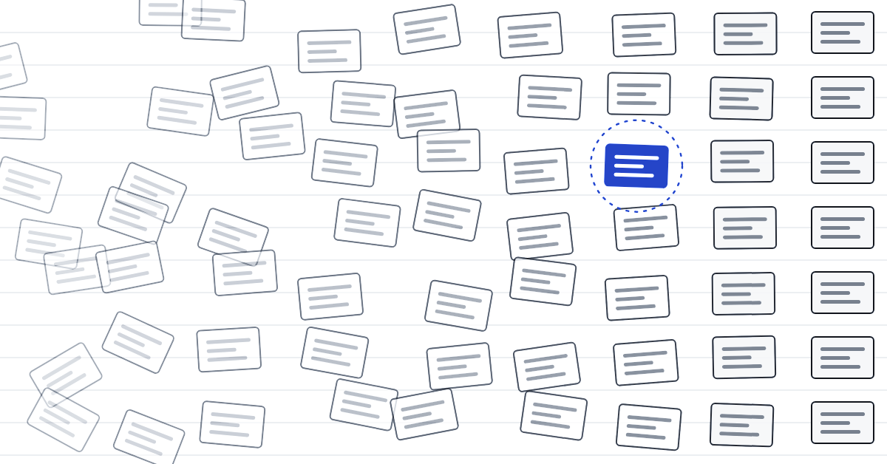

> Source: https://maskin.io/da/bogforing/

# Lad månedens bilag køre i Maskin, så du ved, hvad der skal afklares, mens Maskin laver et udkast og peger på poster, der ser forkerte ud.

## Opgaven
Drop sorteringen af kvitteringer i hånden. Upload dem, og Maskin gemmer dem som udkast i dit eget bogføringssystem. Du beholder dit system og vælger det i den første chat med forløbet. Det, Maskin er usikker på, bliver markeret til dig.

## Vælg dit system
Du bruger ét forløb og vælger dit eget bogføringssystem i den første chat. Her kan du se status for hvert system og den opsætning, der kræves.
| System | Status | Hvad du gør |
| --- | --- | --- |
| Dinero | Kræver opsætning | Du skal have Pro eller Total. En teknisk person tilføjer Dineros egen server som et brugerdefineret værktøj i Maskin og indsætter et adgangstoken fra et login hos Visma. Adgangstokenet gælder omkring en time, og forløbet kan ikke forny det, så du forbinder igen, når det udløber. Det er en tidlig version. Første kørsel tester forbindelsen og fortæller, hvad du skal rette. |
| Numina | Ikke endnu | Forbindelse er ikke mulig endnu. |
| Uniconta | Ikke endnu | Forbindelse er ikke mulig endnu. |
| Odoo 20 | Ikke endnu | Forbindelse er ikke mulig endnu. |
| Business Central | Ikke endnu | Forbindelse er ikke mulig endnu. |
| e-conomic | Ikke endnu | Forbindelse er ikke mulig endnu. |
| Billy | Ikke endnu | Forbindelse er ikke mulig endnu. |
| Zenegy | Ikke endnu | Forbindelse er ikke mulig endnu. |
| Appelsin | Ikke endnu | Ingen åben forbindelse at bygge på. |
Kræver opsætning betyder, at du skal tage det viste trin i dit eget system. Ikke endnu betyder, at intet kan forbindes endnu. Listen i den første chat viser altid den aktuelle status.
Knappen åbner opsætningen af dit forløb.

## Sådan kører det
1. Vælg dit eget bogføringssystem i den første chat med forløbet.
2. Forbind systemet. I Dinero tilføjer du Dineros egen server som et brugerdefineret værktøj under Integrations og sætter adgangstokenet på værktøjet. Det kræver en teknisk person, og tokenet må aldrig indsættes i chatten. Det gælder omkring en time, så du forbinder igen, når det udløber.
3. Upload kvitteringer som foto eller PDF i chatten. Kvitteringer uploades i chatten for nu.
4. Maskin gemmer hver kvittering som et udkast i dit system og markerer det, der kræver et ekstra blik.
5. Du finder udkastene i dit system, ser på de markerede punkter og bogfører selv.

## Det gør forløbet
Forløbet er lavet til hele økonomiopgaven for enhver ejer og ethvert bogføringssystem; lige nu kan kun Dinero forbindes med opsætning, mens de øvrige står som Ikke endnu i tabellen ovenfor. I dag er det kun Dinero, der leverer banklinjer og rapporter, så de opgaver, der skal bruge dem (dagligt kvitteringstjek, månedlig afslutning, momsrapport, tjek af acontoskat og ugentlig pengeoversigt), virker kun med Dinero, indtil andre systemer bliver tilsluttet. Nogle opgaver virker i dag. Andre er under bygning og virker ikke endnu. Tilgængelig betyder, at den virker i dag. Under bygning betyder, at vi bygger den, og at den ikke virker endnu.
**Kvitteringer: send i chatten.** Upload et billede eller en PDF af en kvittering i forløbets chat. Forløbet gemmer den som et udkast i dit eget bogføringssystem og markerer det, der ser forkert ud. *Tilgængelig*
**Kvitteringer: send på mail.** Videresend kvitteringer til en mailadresse, der hører til forløbet. *Under bygning*
**Kvitteringer: dagligt tjek.** Hver dag leder forløbet efter nye kvitteringer, laver udkast og viser bankbetalinger, der stadig mangler en kvittering. Du hører ikke noget, når der ikke er nyt. *Under bygning*
**Tjek af regler.** Hvert udkast bliver tjekket mod danske bogførings- og momsregler, før du ser det. Følger et udkast ikke en regel, markerer forløbet reglen og forklarer kort hvorfor. *Under bygning*
**Månedlig afslutning.** Hver måned matcher forløbet banklinjer med kvitteringer, viser manglende kvitteringer, markerer dubletter og private udgifter, laver udkast til periodiseringer, tjekker momsudkastet og skriver én note med åbne punkter. *Under bygning*
**Momsrapport og tjek af momsangivelse.** For en periode laver forløbet en momsrapport og en eksportfil og tjekker momstallene, før momsangivelsen skal indsendes. Det hele er udkast til gennemgang. *Under bygning*
**Hold øje med frister.** Hver mandag tjekker forløbet de næste frister for moms, A-skat og AM-bidrag, selskabsskat og årets afsluttende dokumenter på Skats og Erhvervsstyrelsens sider med kilde for hver dato. Det siger til, når en frist er inden for 30 dage. *Under bygning*
**Tjek af acontoskat.** I de måneder, hvor acontoskat for selskaber skal betales, sammenligner forløbet beløbet med året indtil nu og laver et udkast til en anbefaling i kroner. *Under bygning*
**Årets afslutning.** Forløbet laver en pakke med udkast til årets afslutning: lukning af året, et udkast til de dokumenter, der skal indberettes for året, og en beregning af selskabsskat. *Under bygning*
**Ugentlig pengeoversigt.** Hver mandag laver forløbet én kort side med kontanter og hvor længe de rækker, avance sammenlignet med sidste uge, status på bogføringen, frister inden for 30 dage og spørgsmål, som kun du kan svare på. *Under bygning*
**Én oversigtsskærm.** Én skærm viser alt, hvad forløbet har gjort, og hvad det har markeret. *Tilgængelig*
Du underskriver, indberetter og betaler selv moms, årets afsluttende dokumenter og selskabsskat til myndighederne. Forløbet forbereder kun udkast.

## Tryghed
**Udkast som standard:** Maskin gemmer udkast, og du bogfører selv i dit eget system. Bogføring er slået fra, til du selv slår den til i Settings.
**Kun udkast, mens bogføring er slået fra:** I Dinero gemmer Maskin kvitteringer som udkast.
**Fejler sikkert:** Kan en kvittering ikke læses, eller passer en postering ikke, kommer den på listen i stedet for at blive gættet.

## Pris
995 kr om måneden ekskl. moms
Dækker hele forløbet: alle opgaverne på listen ovenfor, i dit eget system.
Opgaver, der står som Under bygning, kommer til uden ekstra betaling, når de er klar.

## Tag fat
Tal med Maskin-teamet om, hvordan forløbet passer til din hverdag.
