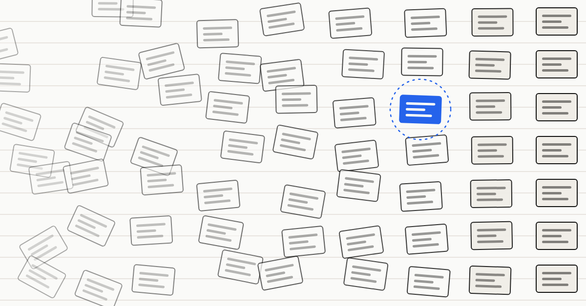
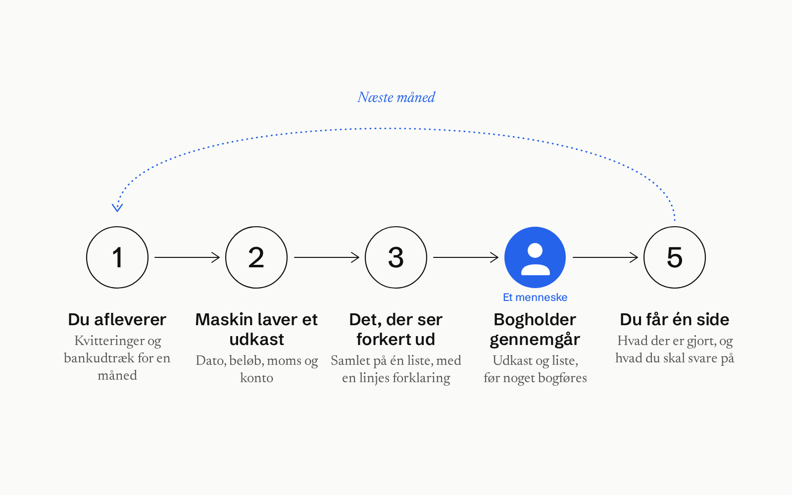

> Source: https://maskin.io/marketplace/accounting/

# Lad månedens bilag køre i Maskin, så du ved, hvad der skal afklares, mens Maskin laver et udkast og peger på poster, der ser forkerte ud.

## Opgaven
Månedens kvitteringer og bankposter samles i et udkast og en liste over punkter, der skal afklares, fx en manglende kvittering eller en betaling, der står to gange. Når tilbuddet starter, gennemgår en bogholder fra en samarbejdspartner udkastet og listen. Du beholder dit eget bogføringssystem, og Maskin bygger ovenpå det. Vil du se forarbejdet til årsafslutningen vist live, før du beslutter dig, er der et gratis webinar på dansk den 25. november i rækken [Sæt strøm til din forretning](/da/saet-stroem/).
Tilbuddet er bygget til at mindske kassen med kvitteringer, jagten på en bogholder og bilagsrod, der først opdages sent.
Det er stadig dig og din bogholder, der svarer på spørgsmål og træffer beslutninger.

## Hvem gør hvad
| Du og bogholderen fra en samarbejdspartner står for | Maskin hjælper med |
| --- | --- |
| Dit eget bogføringssystem | Læser kvitteringer og bankposter |
| Gennemgang af udkast og liste | Samler posteringer i et udkast |
| Svar på spørgsmål om bilag | Finder fx en manglende kvittering |
| Beslutningen om en udgift er privat eller erhverv | Kobler hver post til en kvittering |
| Beslutningen om, hvad der kan bogføres | Samler månedens arbejde og spørgsmål på én side |

## Sådan kører det
1. Månedens kvitteringer og et bankudtræk indgår i forløbet.
2. Maskin læser hver kvittering og bankpost og samler et udkast med dato, beløb, moms, konto og tilhørende kvittering.
3. Maskin laver én liste over det, der ser forkert ud, fx en manglende kvittering, moms der ikke stemmer, en dobbelt betaling, en privat udgift eller et mærkeligt beløb. Hvert punkt får en kort forklaring.
4. Forløbet er indrettet sådan, at en bogholder fra en samarbejdspartner gennemgår udkastet og listen. Først derefter kan noget bogføres, og det gør et menneske.
5. Du får én side for måneden med, hvad der er samlet, hvad du skal svare på, og hvilke punkter der mangler afklaring.

## Tryghed
**Menneskelig gennemgang:** Når tilbuddet starter, gennemgår en bogholder fra en samarbejdspartner udkastet og listen før eventuel bogføring.
**Dine data er dine:** Du beholder dit eget bogføringssystem, og Maskin bygger ovenpå det. Maskin bogfører ikke noget i dit system uden et menneske.
**Fejler sikkert:** En kvittering, der ikke kan læses, eller en post, der ikke passer, kommer på listen i stedet for at blive gættet.

## Pris og timer
995 kr om måneden ekskl. moms
Hjælp fra din bogholder inden for et fast månedligt timebudget.
Tilbuddet starter, når en samarbejdspartner er på plads.

## Tag fat
Tag en snak med Maskin-teamet om, hvordan en måned kan se ud.
