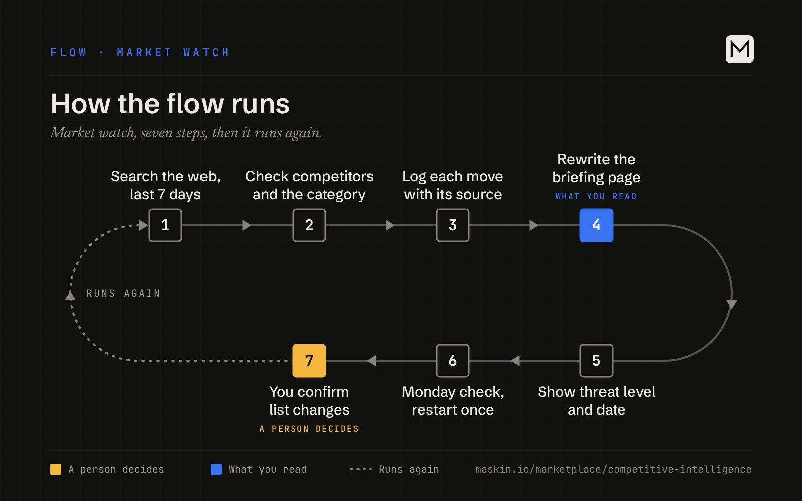

> Source: https://maskin.io/marketplace/competitive-intelligence/

# Know what changed in your market every week.
Run a weekly market watch in Maskin so your team keeps product, positioning and pricing decisions grounded while Maskin scans for changes and writes a sourced briefing.

## The job
Every Sunday, one page is rewritten with a quick read, what needs action, recent storylines, this week’s moves, what matters for the long view, what to watch, and the last four weeks at a glance. Each move has a source link, date and confidence rating, so you can check a price change, such as a new free tier, at its source. Maskin files each real move as an insight. It never creates bets or tasks, so what to do about a move stays with your team.
**Replaces:** manual competitor checks and a dashboard nobody reads twice.
**Stays with your team:** deciding whether a move changes who you sell to, what you claim, or what you charge.

## What your team keeps, what Maskin runs
| Your team keeps | Maskin runs |
| --- | --- |
| Deciding whether a market move needs a response | Scans the last 7 days for competitor, personal agent and category moves |
| Choosing which companies to watch | Checks competitors and proposes list updates for a person to confirm |
| Judging what matters to your business | Reads your positioning and strategy pages to understand what is relevant |
| Checking the evidence behind a move | Adds a source link, date and confidence rating to each note |
| Deciding what to change in your plan | Brings forward what needs a reaction this week, or says “Nothing urgent” |
| Looking beyond this week | Prepares a monthly long view of where the market is heading and whether your plan is right |

## How the flow runs
1. Every Sunday, Maskin scans the web for the last 7 days.
2. It checks competitors, personal agents you can learn from, and the wider category.
3. It skips noise and records each real move as a short note with a source link, date and High, Medium or Low confidence.
4. It rewrites the same briefing page in a fixed order, from an 8-line Quick read to this week’s moves, what to watch and the last four weeks at a glance.
5. The page shows a Low, Medium or High threat level and the date it last changed, and answers whether a move changed who you sell to, what you claim, or what you price.
6. Every Monday, Maskin checks that the scan ran and the page was rewritten. If not, it restarts the scan once, then once more, and tells the workspace owner if it still has not run.
7. Each month, Maskin proposes competitor list changes for a person to confirm, and prepares a longer view of where the market is heading, whether the plan is right, and what to do one year ahead.
Amber steps are human approvals.

## What ships
- **3 agents:** a Market Researcher that runs the weekly sweep, a Market Strategist that writes the monthly long view, and a Briefing Owner that checks every Monday.
- **4 triggers:** the weekly sweep (Sunday, 07:00 UTC), the monthly list review (20th, 09:00 UTC), the monthly long view (3rd, 08:00 UTC) and the Monday check (05:30 UTC).
- **4 skills:** one each for the sweep, the briefing page, the competitor list review and the long-view page.
- **No custom tabs:** the briefing and the long view are pages in your workspace, created on the first run.

## What you need to run it
- Install the flow.
- Add the 5 to 10 competitors you care about, or review and confirm a proposed starting list.
- Keep your positioning and strategy pages in the workspace so Maskin can tell what is relevant.
- Connect no outside accounts and no search tool: the flow ships none, and the agents use the built-in web search and page reading. If your workspace runs on Maskin-funded models, built-in search is switched off and the agents read pages directly.
- See one living briefing page with sourced moves, this week’s priorities and the current threat level.

## Trust surface
- **Human gates:** a person confirms proposed competitor list changes. If your list is empty, Maskin proposes 5 to 10 companies and asks you to confirm.
- **Your data stays yours:** nothing is sent outside the workspace. Maskin does not email competitors or post anywhere.
- **Fails safely:** if the Monday check finds a missed scan or rewrite, Maskin retries twice, then tells the workspace owner.
- **How you are told:** Maskin posts a comment on the flow that mentions the workspace owner for each Act now item and each material move, and when the Monday check cannot get the scan to run. The flow sends no Slack message or email.

## Example week
Example briefing, week of 9 March, for a fictional company, Brightlane (project software for architects).
**Quick read:** Threat level Medium (since 2 March). A rival, Plotwise, cut its entry price by 30% and launched a free tier. Nothing forces a change yet, but the pricing page claim “cheapest for studios” is now weak.
**Act now:** Head of marketing reviews the “cheapest for studios” line by Friday.
**Competitors:** Plotwise, 4 March, new free tier (source link, confidence High). Studiolane, 6 March, hired a head of partnerships from a large CAD vendor (source link, confidence Medium).
**Personal agents:** a personal sketching assistant launched voice notes that turn into tasks. What we can learn: first-run setup takes one minute.
**Category:** two large design-tool vendors added AI search to their base plans (2 sources, confidence Medium).
**Watch next:** whether Plotwise’s free tier has a seat limit. Whether Studiolane announces a partner programme.

## Install this flow in your workspace
Sign in or sign up, then confirm the flow in the Maskin app.
[Install this flow](/install/market-competitor-watch-loop) [Book a walkthrough](https://meshfirm.com/bookmagnus)

## Read next
- [Product discovery flow](/marketplace/product-discovery/): Interviews, tickets, and reviews land as typed insight, and the flow closes when a shaped bet ships against them.
- [Knowledge wiki flow](/marketplace/knowledge-wiki/): Team memory that new hires and new agents bootstrap from.
- [SEO publishing flow](/marketplace/seo-publishing/): One flow from keyword bracket to indexed rank, with humans gating the intent read and the send-to-publish.
- [Outbound flow](/marketplace/outbound/): Prospect research, personalized draft, and reply-handling as one flow, with humans gating the send.
- [What is an AI-native agentic workspace?](/docs/what-is-an-agentic-workspace/): The cornerstone read on the workspace these flows run in.
