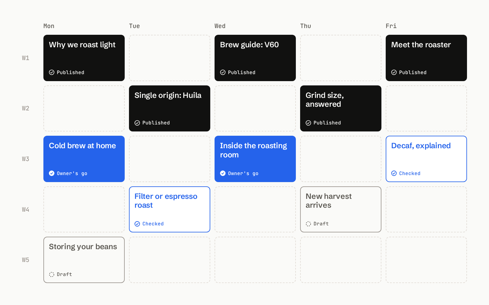
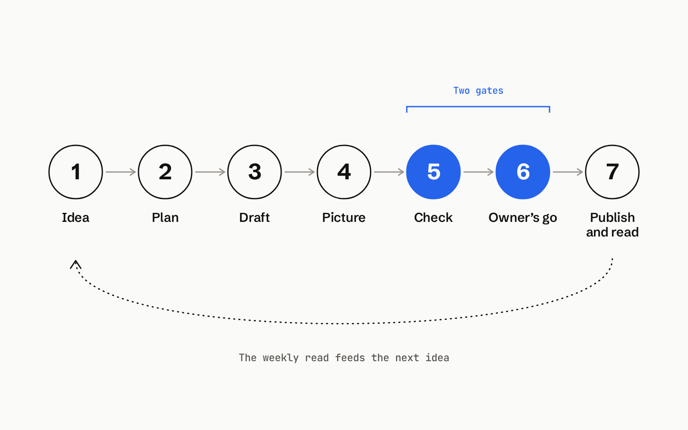

> Source: https://maskin.io/marketplace/content-calendar/

# A content calendar template for a month of posts
Run your content calendar in Maskin so your team decides what to say while Maskin plans the month, drafts to the plan and keeps every post’s status in one place.
[Want the posts written too?](/marketplace/linkedin-content/)

## The job
Plan a month of posts in one calendar. Check and approve each post before it goes out. On a set day each week, read reach and visits by channel to see what each one did.
**Replaces:** a spreadsheet, a scheduling tool’s calendar, a planning retainer.
The topics, real stories and the go on every post stay human.

## Your team keeps / Maskin runs
| Your team keeps | Maskin runs |
| --- | --- |
| The buyer and topics | Collecting questions |
| The real stories and recordings | Planning the month around what the team can really approve |
| The go on each post | Drafting to the plan |
| What is never claimed | Checking each draft against the plan |
|  | Keeping dates and statuses |
|  | The weekly read |

## How the loop runs
1. Bring an idea and its source.
2. Maskin plans the month around what the team can really approve.
3. Maskin drafts to the plan.
4. Choose or add a picture.
5. **Check (human gate):** a team member checks the draft.
6. **Owner’s go (human gate):** the owner approves the post.
7. Publish the post, read weekly reach and visits, then bring the result into the next idea.

## Trust
- A post without the owner’s go does not go out.
- Maskin works from your ideas and calendar and writes back only statuses and links.
- If there is no good idea for a slot, the slot stays empty.

## Run it
[Get the calendar template](/marketplace/content-calendar/content-calendar-template.html)
Start with made-up coffee-roaster example data or a blank calendar; changes stay in your browser, and Export keeps a copy.

## What a content plan needs
- **Buyer:** people choosing coffee to brew at home.
- **Topics:** roast choices, brewing tips and the people behind the roaster.
- **Channels and real capacity:** the channels the team uses and the posts it can review.
- **Ideas with a source:** a customer question or a story from the roasting room.
- **Weekly rhythm:** a regular day to plan, review and publish.
- **Gates:** a team check, then the owner’s go.
- **Measures:** a set weekly read of reach and visits by channel.

## What this loop is built with
Loop
A closed cycle: something fires it (a signal, a schedule, a click), agents do the work, a human gates the taste-sensitive parts, and it ends on a concrete outcome, not on *done for now*. Every listing on the Marketplace is a loop.
**Maskin loops carry typed outcomes and verdicts that persist across tools, not a scheduled run inside one product.**
Agent
A named role a model performs: an SEO analyst, a discovery synthesizer, an outbound writer. Not an *AI teammate*: a role with a job description, tools it can use, and gates it has to pass before its work leaves the workspace.
MCP
The wire an agent uses to reach the tools your team already uses: the CRM, the docs, the inbox, the analytics. If a human on your team can log in and click, an MCP-native agent can be given the same access under the same gates.
Skill
A packaged capability you attach to an agent: *draft a follow-up in our voice*, *summarize a customer call against our discovery template*. Skills are the reusable pieces of judgment your team is already building without realising it.
Inside a loop listing, agents / MCPs / skills appear as “built with” components of the loop, never as top-level marketplace sections of their own.

## FAQ

### What views does the calendar file have?
Month, week, list and board views.

### Can I change a post’s date?
Yes. Drag it to reschedule.

### Can I set a weekly goal?
Yes. The calendar file supports a weekly goal per account.

### What marks can the calendar file show?
Two marks: Checked (shown as E) and Owner’s go (shown as Go).

### Can I start blank or use a CSV?
Yes. The calendar file has a blank start and supports CSV in and out.

### What does the weekly read cover?
Reach and visits by channel.

### What should a content calendar include?
Include buyer, topics, channels and the posts the team can review, sourced ideas, a weekly day to plan, review and publish, a team check then the owner’s go, and a weekly read of reach and visits by channel. The list above shows all seven for a made-up coffee roaster.
Related loops on the marketplace
