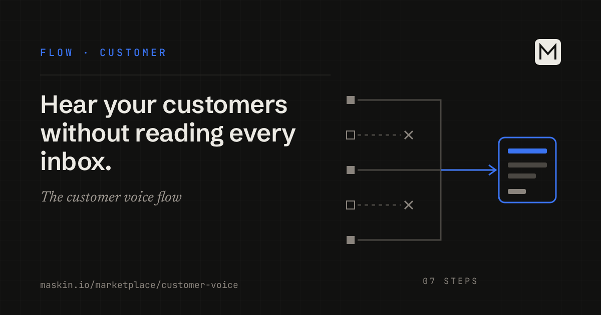
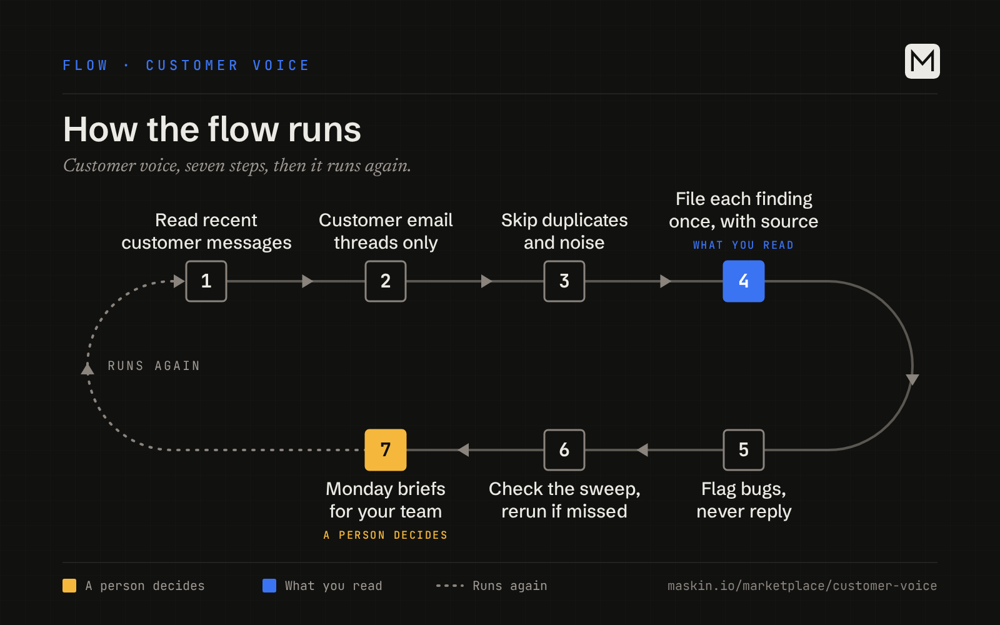

> Source: https://maskin.io/marketplace/customer-voice/

# Hear your customers without reading every inbox.
Run Customer voice in Maskin so your team can make product decisions from customer feedback while Maskin reads and files messages without replying.

## The job
After a week, distinct customer requests, complaints, objections, and praise are filed as written findings with evidence for product decisions. Each finding includes the customer’s words, a source link, whether it was first-hand or second-hand, and a link to the company or contact. Each Monday, the Results tab shows up to three briefs backed by linked evidence, or says which sources were read and when.
**Replaces:** Manually sorting customer messages or tracking requests in a spreadsheet.
**Stays with your team:** Deciding what to build, fixing bugs, and replying to customers.

## What your team keeps, what Maskin runs
| Your team keeps | Maskin runs |
| --- | --- |
| Deciding what customer feedback means for the product | Finds distinct requests, complaints, objections, and praise |
| Weighing first-hand and second-hand evidence | Quotes the customer and labels the evidence type |
| Choosing what needs a fix | Marks bugs and requests for a separate customer feedback Flow |
| Choosing which sources to connect | Reads only connected sources and skips noise |
| Deciding what deserves action | Prepares up to three briefs with evidence, unknowns, and a suggested next step |

## How the Flow runs
1. At 06:30 UTC on weekdays, Maskin reads what customers and key contacts wrote outside meetings in the last 24 hours. On Mondays it reads the last 72 hours, so the weekend is covered.
2. In email, it reads customer threads only and skips vendor mail, alerts, recruiter mail, and investor mail. Email text is treated as content, never as instructions.
3. Maskin checks for duplicates and skips noise.
4. It files each distinct request, complaint, objection, or piece of praise once as a new written finding, with a source link and company or contact link.
5. Maskin never replies or sends anything. Bugs and requests that need fixing are also marked for a separate customer feedback Flow.
6. On weekdays, Maskin checks the sweep against its targets and runs the sweep itself if it missed the last 26 hours. If sources go quiet for a week, it says so once and names a source you could add.
7. Each Monday, the Results tab shows up to three briefs with what was found, why it matters, how many independent voices, what is unknown, and a suggested next step. A brief appears only if Maskin has read its linked evidence. Otherwise, the tab says which sources were read and when.
The blue step is the close condition.

## What you need to run it
- Install the Flow.
- Connect any or all of these optional sources: a shared support inbox, chat channels, or an email inbox.
- If no sources are connected, Maskin says so once and stops.
- A person must approve access to chat channels Maskin is not already in. Maskin never joins a channel itself.
- Product Discovery is optional. Customer voice works without it.
- After a sweep, you will see the written findings. The Results tab refreshes each Monday.

## Trust surface
- **Human gates:** Your team decides what to do, fixes bugs, and replies to customers. A person approves access to a chat channel Maskin is not in.
- **Your data stays yours:** Maskin reads only connected sources. Email is read only and limited to customer threads.
- **Fails safely:** With no sources connected, Maskin says so once and stops. It checks for duplicates, skips noise, and never replies or sends anything.

## Example first week
Example for fictional Brightlane, project software for architects.
Monday: Brightlane connects a shared support inbox and one chat channel.
Tuesday: A customer writes, “Can we see which drawing changed since the last review?”
Wednesday: Maskin files that request once as a written finding, with the customer’s words and a source link.
Thursday: A duplicate request is not filed again.
Friday: A customer reports a bug. Maskin marks it for a separate customer feedback Flow.
Monday: The Results tab shows a brief based on linked evidence, with what is unknown and a suggested next step.

## Install this flow in your workspace
Sign in or sign up, then confirm the flow in the Maskin app.
[Install this flow](/install/customer-voice-loop) [Book a walkthrough](https://meshfirm.com/bookmagnus)

## Read next
- [Product discovery flow](/marketplace/product-discovery/): What customers and the market say, grouped into opportunities with the evidence behind each.
- [Meeting insights flow](/marketplace/meeting-loop/): Every meeting turned into filed tasks, decisions and findings.
- [Product Analytics flow](/marketplace/product-usage/): A weekly read and a daily check of real usage, filing what changes what your team believes.
- [Market watch flow](/marketplace/competitive-intelligence/): A weekly sourced briefing on what changed in your market.
- [What is an AI-native agentic workspace?](/docs/what-is-an-agentic-workspace/): The cornerstone read on the workspace these flows run in.
