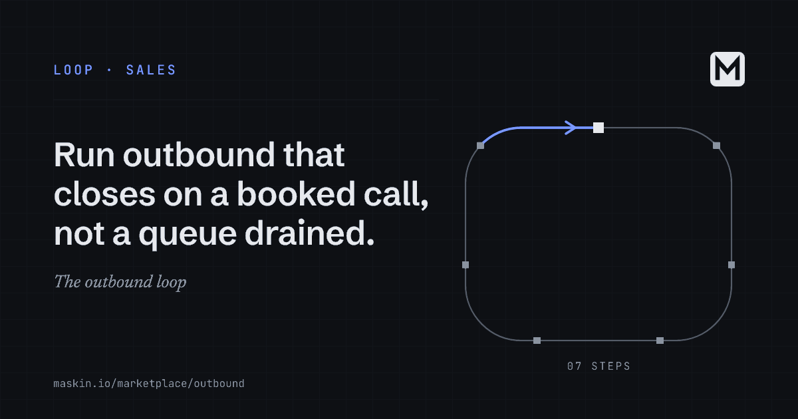

> Source: https://maskin.io/marketplace/outbound/

# Run outbound that closes on a booked call, not a queue drained.
Prospect research, personalized draft, reply-handling as one flow — humans gate the send, agents wire the rest.
This flow can't be installed yet. In the meantime, [try Maskin](/signup).

The outbound flow closes on the outcome (call booked, or a clean disqualify), not the activity (emails queued). A signal fires it — an in-ICP hire, a funding round, a jobs post. Agents research the account, draft the sequence, wait for a human send-gate, track replies, and either book or archive. Every touchpoint stays typed against the same account object, so nothing is retyped between the enrichment tool, the sender, and the CRM.
For product-led teams whose first sales motion is founder-run or PM-run and can’t afford a rep-shaped stack yet.
There is no walkthrough video for this flow yet.

## What a cold email flow gets you
The outbound flow closes the gap between “this account matched our ICP” and “a warm reply is in the account owner’s inbox.” It runs continuously against a signal feed, drafts personalised messages, sends only what a human has approved, and routes replies back to the humans who can close them. The wedge over closed AI SDR SaaS isn’t the model — it’s the flow shape and the audit trail. The same workspace also runs the [LinkedIn content flow](/marketplace/linkedin-content/), which keeps a founder-voice LinkedIn presence going alongside outreach.
- **Every prospect, message, and reply is a queryable row.** The state lives on Maskin’s typed object graph, not a vendor dashboard. That’s the audit trail your GTM leader wants.
- **Human-on-the-loop with a measured [override rate](/docs/learn/human-in-the-loop-ai/)** is the operational difference between a working flow and a demo. Stuck at 0% is rubber-stamping; above 20% is a broken model; the real gate sits in the middle band.
- **The sender lane is your own.** LinkedIn via Unipile’s MCP, or a warmed email domain via Postmark or Resend — not a shared pool that gets your primary domain blacklisted when one prompt regression fires.

## The seven-step cold email flow
1. **Signal** A prospect matches the ICP or a triggered event fires — a job change, a funding round, a competitor’s customer showing account activity.
2. **Research** An agent enriches the account and contact, pulls the last 90 days of public signal, drafts a hypothesis on why now.
3. **Draft** An agent writes a first-touch message calibrated to the researched signal, in the sender’s voice.
4. **Human approval** A human reviews the draft — or a sampled fraction of drafts, if the volume warrants — before it sends. The override rate is measured and watched over time.
5. **Send** The message goes out through the sender lane (LinkedIn via Unipile, or a warmed email domain via Postmark or Resend).
6. **Reply routing** Replies are classified as warm (route to the account owner as a booked-conversation candidate), objection (route back to the agent for the follow-up sequence), or unsubscribe (honour and suppress).
7. **Close** A meeting booked, or the sequence exits without conversion after N touches. The outcome updates the flow’s win-rate metrics.
Amber steps are human approvals. The blue step is the close condition.

## What this flow is built with
Named the same on every flow page so the shape is portable. Below the fold on purpose — the flow is what closes; the primitives are just the parts. Inside a flow listing, agents / MCPs / skills appear as “built with” components of the flow, never as top-level marketplace sections of their own.
Flow
A closed cycle: something fires it (a signal, a schedule, a click), agents do the work, each is accountable for its own job, and it ends on a concrete outcome — not on *done for now*. Every listing on the Marketplace is a flow. Maskin flows carry typed outcomes and verdicts that persist across tools, not a scheduled run inside one product.
Agent
A named role a model performs — an SEO analyst, a discovery synthesizer, an outbound writer. Not an *AI teammate*: a role with a job description, tools it can use, and gates it has to pass before its work leaves the workspace.
MCP
The wire an agent uses to reach the tools your team already uses — the CRM, the docs, the inbox, the analytics. If a human on your team can log in and click, an MCP-native agent can be given the same access under the same gates.
Skill
A packaged capability you attach to an agent — *draft a follow-up in our voice*, *summarize a customer call against our discovery template*. Skills are the reusable pieces of judgment your team is already building without realising it.
Full concept map: [Agent skills vs MCP vs cursor rules vs workflows](/docs/agent-skills-vs-mcp-vs-cursor-rules-vs-workflows/) explains where each layer belongs. Concrete step-by-step build: [How to build an AI SDR flow in Maskin](/docs/how-to-build-ai-sdr-loop/). Honest OSS landscape: [Open source AI SDR](/alternatives/open-source-ai-sdr/).

## Cold email vs outbound sales: when the closed AI SDR SaaS is still the right answer
An AI SDR without a human approval gate is one bad prompt away from your domain being blacklisted. If your team doesn’t have the GTM engineering to own deliverability, sender-reputation, and prompt-quality tuning, the closed bill is a service contract, not a rip-off — and 11x, Artisan, Qualified, SalesForge, and AiSDR are all reasonable answers. The flow wins when the team already runs its own outbound stack and would rather own the state than rent it. Both answers are defensible; pretending otherwise is what makes most OSS-alt content read as sales copy. Outbound also assumes someone has already decided which accounts are worth a message; for the inbound side of the same question, the [lead qualification flow](/marketplace/lead-qualification/) gates each lead with a human call before a rep touches it.

## Read next
- [How to build an AI SDR flow](/docs/how-to-build-ai-sdr-loop/): The seven-step concrete build for running an AI SDR flow on Maskin's typed object graph.
- [Open source AI SDR](/alternatives/open-source-ai-sdr/): Honest map of the six OSS AI SDR repos and the cost split against closed SaaS.
- [The SEO publishing flow](/marketplace/seo-publishing/): Keyword bracket to indexed rank on your own site, without hand-writing HTML.
