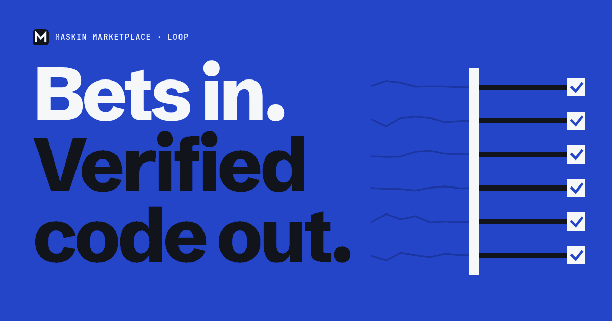

> Source: https://maskin.io/marketplace/product-delivery/

# Bets in. Verified code out.
Hire four digital employees for the job of taking a shaped bet to shipped, checked code. They plan the work, build it, review every change, prove the result against the bet’s own success criteria, and tell you whether it worked.

A shaped bet goes in. Code that has been built, reviewed and checked against the bet’s own success criteria comes out.

## The job
A bet is only done when the change is live and the numbers say it worked. Most teams lose that second half. The ticket closes when the code merges, nobody goes back to check the result, and the next planning meeting starts from memory.
This flow keeps both halves attached. A bet moves to define and the Delivery Lead checks its Won and Lost criteria can be measured with the data you already collect, and proposes them in numbers. Each task has an owner and a branch. The Developer builds every change and opens the pull request, the Reviewer checks it against its task, and the Delivery Lead merges when the checks pass. After it ships, the flow reads your product data and your customer feedback and posts a verdict on the bet. If you also want a weekly read of how people use the product, outside any one bet, the [product usage flow](/marketplace/product-usage/) files what changed or contradicts what your team believes. The six stages are laid out in [agentic SDLC explained](/docs/learn/agentic-sdlc/).
It is the output side of the [product discovery flow](/marketplace/product-discovery/): discovery turns customer signal into a shaped bet, delivery turns that bet into shipped, verified code. The [bet-based planning](/docs/bet-based-product-planning/) method sits underneath both. Once a change is merged, the [product release flow](/marketplace/product-release/) bundles it into a release, prepares the notes and reads back that they are really live.
**Replaces:** sprint-planning ceremonies · a delivery lead chasing status across tickets and pull requests · hand-run release checklists · close-out reviews nobody gets round to.
**Your team owns:** which bets are worth shaping · the product calls the flow cannot make · what goes back into discovery · how the work fits the roadmap.

## Your team and Maskin: who does what
| Your team keeps | Maskin runs |
| --- | --- |
| The taste on which bets are worth shaping | The Delivery Lead sets measurable success criteria and owns the verdict after release |
| The product calls the flow cannot make | The Developer builds each task, runs the change and opens the pull request |
| What goes back into discovery | The Reviewer checks every change against the task it came from |
| How the work fits the roadmap | The Coordinator keeps tasks moving and dispatches the final review when the last one passes |
| Which bets you stop or reshape | The release check scores risk and the merge runs under the rules below |

## How the flow runs
1. A bet moves to define. The Delivery Lead checks its Won and Lost criteria can be measured with the data you already collect, proposes them in numbers, and flags any that cannot be measured.
2. A task under the bet is ready to build. The Developer reads the task and the bet’s spec, builds the change, runs it, and opens a pull request against the bet’s branch.
3. The Reviewer checks the pull request against the task’s acceptance criteria at the current commit, runs the change, and posts a verdict with a risk level.
4. A change that passes goes to the Delivery Lead, who merges it when CI is green and the risk is low or medium, or turns on auto-merge while CI finishes.
5. A three-hourly sweep picks up any passed pull request left unmerged, and any bet branch already merged with open tasks behind it.
6. When the last task under a bet passes review, the Coordinator dispatches the bet’s final review.
7. The bet’s branch gets one review across the whole change, then the same merge check.
8. When the bet reaches live, the Delivery Lead reads your product data and posts a Won, Lost or Inconclusive verdict.
9. It then reads what customers and your own team said and posts a second verdict next to the first. The bet is live and its verdict is posted, which is where the flow closes.
10. Outside any one bet, a daily sweep watches your analytics for error spikes and drop-offs, and a weekly briefing says what shipped and what is stuck.
The blue step is the close condition.

## What you need to run it
- **What you get:** four digital employees (a Delivery Lead, a Developer, a Reviewer and a Coordinator), ten automated steps, and two skills (the merge gate and the task handoff rules).
- **Connect your own code host.** The flow opens pull requests there, has them reviewed, and merges them under the rules on this page. Until it is connected, the steps that need it say so once and stop.
- **Connect your own product analytics tool** if you want the verdict after release read from real usage. The daily sweep and the verdict switch themselves off until it is connected.
- **It starts when a bet moves to define or active, or when a task under an active bet is ready to build.** It closes when the bet is live and its verdict is posted. Shaping the bet and sizing it stay in your own process.
- **No targets ship with it.** You add the ones you want to track in your own workspace.

## What you can rely on
- **Merge rules you can read:** the Delivery Lead merges only when the Reviewer has passed the change at its current commit, CI is green and the risk is low or medium. A high-risk change goes to the person who owns the repository. Passed changes are swept up every three hours, so none sits waiting.
- **Your code stays yours:** Maskin works through your repository and your pull requests. The history lives in your repo and on the bet, not in a shadow system.
- **Fails safely:** if a change fails review or the release check, it stops there and goes back to the task. A safety-net sweep also catches any merged pull request whose bet was left open.

## Pick per bet, not per team
You don’t have to move everything. Run this flow on the bets that suit it, such as AI-heavy work or small teams with tight engineering time, and keep the rest in Jira or Linear. Both paths read from the same shaped bet and write the result back to the same place. If you are weighing a full move off Jira, the [open source Jira alternative](/alternatives/open-source-jira-alternative/) page compares the open source trackers with this bet-based approach. The [product teams guide](/solutions/product-teams/) walks through both paths.

## Frequently asked questions

### What is agentic software development?
Software work where digital employees each own a step: checking the success criteria, building, reviewing, merging and judging the result. In Maskin they work inside a flow, from a shaped bet, and the result is checked against what the bet said success would look like.

### Does it replace my engineers?
No. You hire the flow for the job of taking a bet to shipped, checked code. Your team still decides which bets are worth shaping and owns the product calls the flow cannot make.

### Do I have to leave Jira or Linear?
No. Pick per bet. Run this flow on the bets that suit it and keep the rest in Jira or Linear. Both read from the same shaped bet and write the result back to the same place.

### What happens when a change fails review?
It goes back to the task with the reason, and the Developer picks it up again. A high-risk change is the one case that goes to the person who owns the repository.

### What do I need to connect?
Your own code host, and a product analytics tool if you want the verdict read from real usage. The steps that need one switch off until it is connected.

### Where does my code live?
In your repository. Maskin works through your repo and your pull requests, so the history stays there and on the bet.

### How do I know the bet worked?
You write the Won and Lost criteria first, and Maskin checks they can be measured with data you already collect. After release it reads your product data and posts a Won, Lost or Inconclusive verdict, then reads customer and team feedback and posts a second one. Both verdicts sit on the bet with the evidence behind them.

## Proof
The Maskin Team runs its own product delivery on Maskin, live at maskin.io. Planning, building, review, release check and verdict all run inside the product described on this page.

## Run it
See the flow run, then decide whether to run it on your repo. Or [start your workspace](https://maskin.io/signup).

## Install this flow in your workspace
Sign in or sign up, then confirm the flow in the Maskin app.
[Install this flow](/install/product-delivery-loop)

## What this flow is built with
Named the same on every flow page so the shape is portable. Below the fold on purpose — the flow is what closes; the primitives are just the parts. Inside a flow listing, agents / MCPs / skills appear as “built with” components of the flow, never as top-level marketplace sections of their own.
Flow
A closed cycle: something fires it (a signal, a schedule, a click), agents do the work, each is accountable for its own job, and it ends on a concrete outcome — not on *done for now*. Every listing on the Marketplace is a flow. Maskin flows carry typed outcomes and verdicts that persist across tools, not a scheduled run inside one product.
Agent
A named role a model performs — an SEO analyst, a discovery synthesizer, an outbound writer. Not an *AI teammate*: a role with a job description, tools it can use, and gates it has to pass before its work leaves the workspace.
MCP
The wire an agent uses to reach the tools your team already uses — the CRM, the docs, the inbox, the analytics. If a human on your team can log in and click, an MCP-native agent can be given the same access under the same gates.
Skill
A packaged capability you attach to an agent — *draft a follow-up in our voice*, *summarize a customer call against our discovery template*. Skills are the reusable pieces of judgment your team is already building without realising it.

## Read next
- [The product discovery flow](/marketplace/product-discovery/): What feeds this flow.
- [The LLM knowledge wiki flow](/marketplace/knowledge-wiki/): The context agents read before they plan.
- [The SEO publishing flow](/marketplace/seo-publishing/): Another shaped bet turned into a shipped page.
