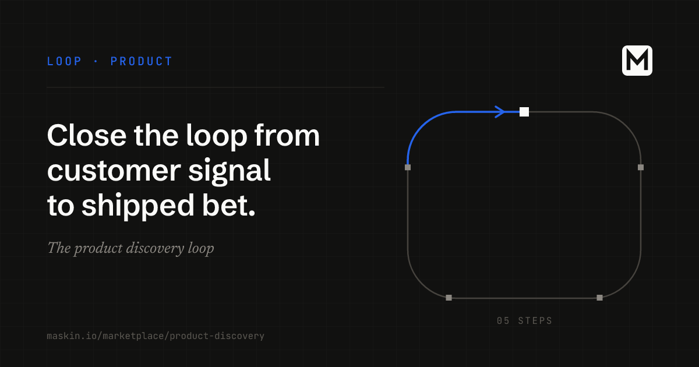

> Source: https://maskin.io/marketplace/product-discovery/

# Close the loop from customer signal to shipped bet.
Maskin reads customer calls, requests and market news against your strategy, so you know what to build next, with evidence behind every opportunity.
1. Build your strategy
Write down what matters to your team. Maskin uses it to check everything it hears.
2. Find the right opportunities
Maskin reads customer calls and sales meetings, watches competitors and the market, and groups what it hears into opportunities with the evidence behind each.
3. Turn them into bets
Strong opportunities become bets staged at the opportunity status in your workspace.
4. Test them with customers
Your team runs the customer tests, using the evidence Maskin brings.
You decide which opportunities to take on. Nothing moves forward without your call.
*Where this is going:* opportunities shown sized and ranked, and a product brief and prototype before you commit. Neither is available yet.

The goal is a shipped bet tied back to what customers said, not an interview scheduled. Maskin continuously takes in customer calls, sales meetings, and customer and community feedback, and watches competitors and the market. An agent keeps your written-down strategy up to date. Maskin checks what it hears against that strategy, then groups it into opportunities with the evidence behind each one. Strong opportunities become bets staged at the opportunity status in your workspace, and custom views let you shape how results look for your team. A person decides what moves forward. Checking, after a bet ships, whether it eased the problem is where this loop is heading. The same approach applies on the retention side, with [the same signal-to-bet pattern applied to churn](/docs/at-risk-account-alerts/). Shipped bets are also the raw material for the [LinkedIn content loop](/marketplace/linkedin-content/), which turns what shipped this fortnight into posts the account owner approves. Once a bet is shaped, the [product delivery loop](/marketplace/product-delivery/) can take it from there: it plans the work, builds and reviews every change, and checks the result against the success criteria you wrote first. If you synthesize research in Claude Code today, [Claude Code for product managers](/docs/learn/claude-code-for-product-managers/) covers what that setup does well and where a team record takes over.
For product teams whose research folder never quite makes it into the roadmap.
Or email [ai@maskin.io](mailto:ai@maskin.io?subject=Waitlist:%20product%20discovery%20loop) with subject “Waitlist: product discovery loop” and we’ll send it the moment it drops.

## What this loop is built with
Named the same on every loop page so the shape is portable. Below the fold on purpose — the loop is what closes; the primitives are just the parts. Inside a loop listing, agents / MCPs / skills appear as “built with” components of the loop, never as top-level marketplace sections of their own.
Loop
A closed cycle: something fires it (a signal, a schedule, a click), agents do the work, a human gates the taste-sensitive parts, and it ends on a concrete outcome — not on *done for now*. Every listing on the Marketplace is a loop. Maskin loops carry typed outcomes and verdicts that persist across tools, not recurring workflow execution inside one product.
Agent
A named role a model performs — an SEO analyst, a discovery synthesizer, an outbound writer. Not an *AI teammate*: a role with a job description, tools it can use, and gates it has to pass before its work leaves the workspace.
MCP
The wire an agent uses to reach the tools your team already uses — the CRM, the docs, the inbox, the analytics. If a human on your team can log in and click, an MCP-native agent can be given the same access under the same gates.
Skill
A packaged capability you attach to an agent — *draft a follow-up in our voice*, *summarize a customer call against our discovery template*. Skills are the reusable pieces of judgment your team is already building without realising it.
