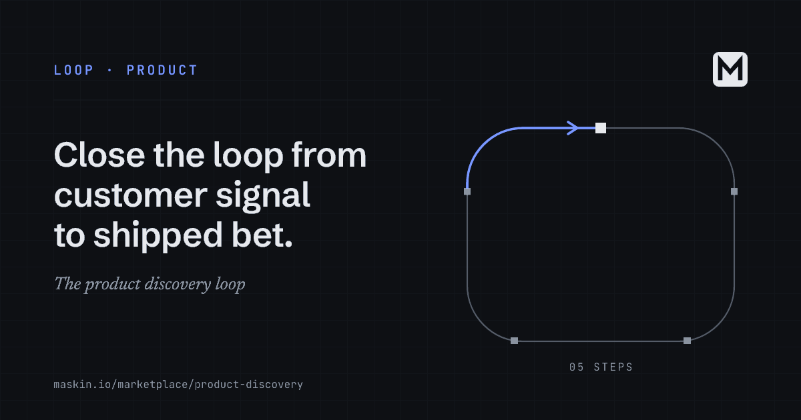

> Source: https://maskin.io/marketplace/product-discovery/

# Continuous product discovery from customer signal to a shipped bet
Maskin reads customer calls, requests and market news against your strategy, so you know what to build next, with evidence behind every opportunity.

You decide which opportunities to take on. Nothing moves forward without your call.
*Where this is going:* opportunities shown sized and ranked, and a product brief and prototype before you commit. Neither is available yet.
The goal is a shipped bet tied back to what customers said, not an interview scheduled. Maskin takes in customer calls, sales meetings, and customer and community feedback, and watches competitors and the market, on a set schedule rather than in real time. An agent keeps your written-down strategy up to date. Maskin checks what it hears against that strategy, then groups it into opportunities with the evidence behind each one. Strong opportunities become bets staged at the opportunity status in your workspace, and custom views let you shape how results look for your team. A person decides what moves forward. Checking, after a bet ships, whether it eased the problem is where this flow is heading. For the usage side, the [product usage flow](/marketplace/product-usage/) reads real human usage each Monday and files findings that challenge what your team believes. The same approach applies on the retention side, with [the same signal-to-bet pattern applied to churn](/docs/at-risk-account-alerts/). Shipped bets are also the raw material for the [LinkedIn content flow](/marketplace/linkedin-content/), which turns what shipped this fortnight into posts the account owner approves, and for the [content calendar](/marketplace/content-calendar/), where every idea comes with its source. Once a bet is shaped, the [product delivery flow](/marketplace/product-delivery/) can take it from there: it plans the work, builds and reviews every change, and checks the result against the success criteria you wrote first. If you synthesize research in Claude Code today, [Claude Code for product managers](/docs/learn/claude-code-for-product-managers/) covers what that setup does well and where a team record takes over. One more read feeds the same opportunities: the [customer voice flow](/marketplace/customer-voice/) files what customers write as findings. If you’re weighing this flow against Productboard, a separate page sorts [Productboard alternatives by the job you’re missing](/alternatives/productboard/).
For product teams whose research folder never quite makes it into the roadmap.

## See it run

## The 4-step flow
1. **Build your strategy** Write down what matters to your team. Maskin uses it to check everything it hears.
2. **Find the right opportunities** Maskin reads [customer calls and sales meetings](/loops/ai-customer-feedback-loop/), [watches competitors](/marketplace/competitor-watch/) and the market, and groups what it hears into opportunities with the evidence behind each.
3. **Turn them into bets** Strong opportunities become bets staged at the opportunity status in your workspace.
4. **Test them with customers** Your team runs the customer tests, using the evidence Maskin brings.

## What you need to run it
- Install the flow, then add a short strategy page about who you sell to and what you believe. The flow compares feedback with this page.
- Optional: connect sources you already use, such as product analytics, meeting transcripts, team chat or email. No outside account is needed.
- The flow reviews new notes every weekday, groups repeated themes three mornings a week, and rechecks stale opportunities on a schedule. Weak ones can be paused.
- Every Sunday, two living pages are updated and checked: what the team understands about customers, and what that means for each opportunity. A Monday briefing tells one connected story of what was learned and what is worth a look.
- A person moves an opportunity forward. The flow does not yet show opportunities sized and ranked, or create a product brief and prototype before you commit.

## Opportunity backlog
The opportunities waiting at opportunity status are your team’s opportunity backlog. A person decides which ones move on to shaping. See [how a bet differs from a backlog ticket](/docs/bet-vs-backlog/).

## Example week
Example Monday briefing for a fictional company, Brightlane (project software for architects).
“This week’s story: studios keep asking for offline site-visit notes. Four notes from three sources point to the same gap: two calls, one support request and one forum thread. One note from a larger firm points the other way. One opportunity, ‘offline site notes’, moved from new to worth shaping. Weakest link: no one has said they would pay for it. Next step for a person: decide whether to shape it this week. Also this week: two stale opportunities were paused for lack of evidence.”

## What this flow is built with
Named the same on every flow page so the shape is portable. Below the fold on purpose — the flow is what closes; the primitives are just the parts. Inside a flow listing, agents / MCPs / skills appear as “built with” components of the flow, never as top-level marketplace sections of their own.
Flow
A closed cycle: something fires it (a signal, a schedule, a click), agents do the work, a human gates the taste-sensitive parts, and it ends on a concrete outcome — not on *done for now*. Every listing on the Marketplace is a flow. Maskin flows carry typed outcomes and verdicts that persist across tools, not a scheduled run inside one product.
Agent
A named role a model performs — an SEO analyst, a discovery synthesizer, an outbound writer. Not an *AI teammate*: a role with a job description, tools it can use, and gates it has to pass before its work leaves the workspace.
MCP
The wire an agent uses to reach the tools your team already uses — the CRM, the docs, the inbox, the analytics. If a human on your team can log in and click, an MCP-native agent can be given the same access under the same gates.
Skill
A packaged capability you attach to an agent — *draft a follow-up in our voice*, *summarize a customer call against our discovery template*. Skills are the reusable pieces of judgment your team is already building without realising it.

## Install this flow in your workspace
Sign in or sign up, then confirm the flow in the Maskin app.
[Install this flow](/install/product-discovery-loop)
