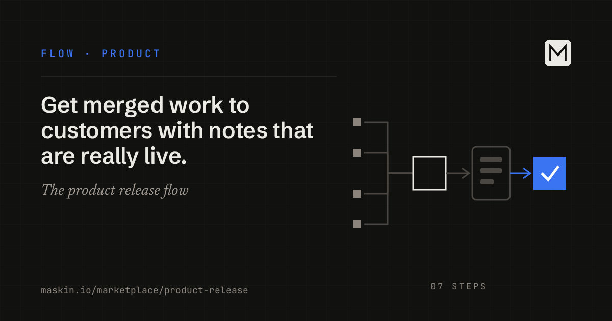
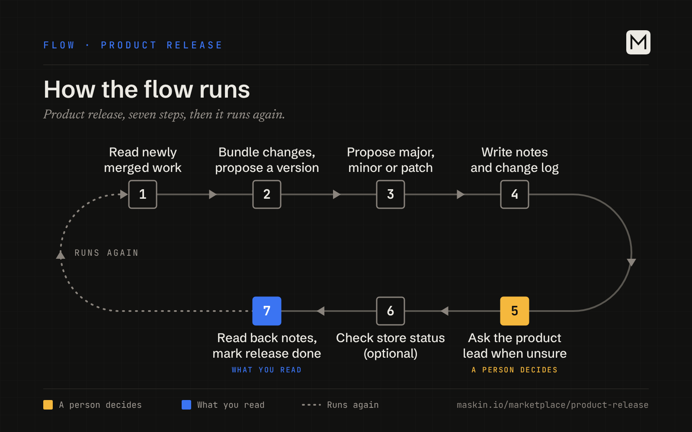

> Source: https://maskin.io/marketplace/product-release/

# Get merged work to customers with notes that are really live.
Run Product release in Maskin so your team gets merged work out to customers with notes that are really live while Maskin bundles changes and checks release status.

## The job
Your release is live on every surface it covers, its change log is written, and notable releases have their in-app note and public entry live and read back.
**Replaces:** Manual release bundling, note writing, and status chasing.
**Stays with your team:** Merging code, publishing the public entry, and handling positioning shifts or release-type disagreements.

## What your team keeps, what Maskin runs
| Your team keeps | Maskin runs |
| --- | --- |
| Merging code | Reads merged work from your main branch, but never merges code |
| Deciding how to handle a positioning shift | Asks a person when a release involves a positioning shift |
| Settling whether a change is notable if product and tech leads disagree | Asks the product lead when unsure, and records the decision |
| Publishing the public release-log entry | Prepares the entry and hands it to whoever publishes your site |
| Handling store rejections or requests for a store-only screen | Reports the issue and asks a person to take the next step |
| Owning the release outcome | Reads back notes, records dates, and marks the release done or names what is missing and who owns it |

## How the Flow runs
1. On Monday and Thursday at 08:00 UTC, Maskin reads work merged to your main branch since the last release.
2. It groups every user-facing change into an open release bundle for that release, and proposes one version number for web and apps.
3. It proposes a major release type for breaking or large changes, minor for a new capability, or patch for fixes only. It lists customer-facing features or goals, leaving out internal plumbing.
4. For a notable release, Maskin prepares What's New text, an in-app announcement note, and a public release-log entry. For a patch, it prepares one short change-log line and no announcement.
5. If Maskin is unsure whether a change is notable, it asks the product lead, then records its decision. A person is needed for a positioning shift or if product and tech leads cannot settle the release type.
6. If you connect a store, an optional weekday check at 08:00 UTC reports each app version's state and who takes the next step. It comments only when the state changes, retries a temporary submission failure once, and asks a person only for a store rejection or a store-only screen.
7. When a release moves to "in review" (meaning live), Maskin reads back the notes, records the live date and note date, and adds a customer date to each listed feature or goal. It marks the release done or names what is missing and who owns it.
Amber steps are human approvals. The blue step is the close condition.

## What you need to run it
- Install the Flow.
- Connect your code host. This is required for release bundling.
- If no code host is connected, the bundle step says so once and stops.
- Connect your store for the optional app version check. If no store is connected, that step switches itself off.
- At the first scheduled check, you will see a release bundle with grouped changes and a proposed version and release type.

## Trust surface
- **Human gates:** A person is needed for a positioning shift, a store rejection, a store-only screen, or when product and tech leads cannot settle whether a change is notable.
- **Your data stays yours:** You connect your own code host and optional store. Maskin never merges code and does not publish to your website.
- **Fails safely:** Without a code host, bundling stops. A temporary store submission failure gets one retry. Missing release items are named with an owner.

## Example first week
Example for fictional Brightlane, project software for architects.
- Day 1, Monday: Maskin finds two user-facing changes merged since the last release.
- Day 1: It groups them into a release bundle and proposes a minor release type because one adds a new capability.
- Day 1: It lists the customer-facing feature or goal and leaves internal plumbing out.
- Day 2: The product lead confirms the change is notable.
- Day 2: Maskin prepares the release notes. The What's New text reads: "Share a project with a client without asking them to sign up."
- Day 3: The optional store check reports the app version's state and who takes the next step.
- Day 4: The release moves to "in review," meaning live.
- Day 4: Maskin reads back the notes, records the dates, adds a customer date to the feature or goal, and marks the release done.

## Install this flow in your workspace
Sign in or sign up, then confirm the flow in the Maskin app.
[Install this flow](/install/product-release-loop) [Book a walkthrough](https://meshfirm.com/bookmagnus)

## Read next
- [Product delivery flow](/marketplace/product-delivery/): Bets in, verified code out.
- [Customer voice flow](/marketplace/customer-voice/): Customer messages filed as written findings, never replied to.
- [Product discovery flow](/marketplace/product-discovery/): What customers and the market say, grouped into opportunities with the evidence behind each.
- [Product Analytics flow](/marketplace/product-usage/): A weekly read and a daily check of real usage, filing what changes what your team believes.
- [What is an AI-native agentic workspace?](/docs/what-is-an-agentic-workspace/): The cornerstone read on the workspace these flows run in.
