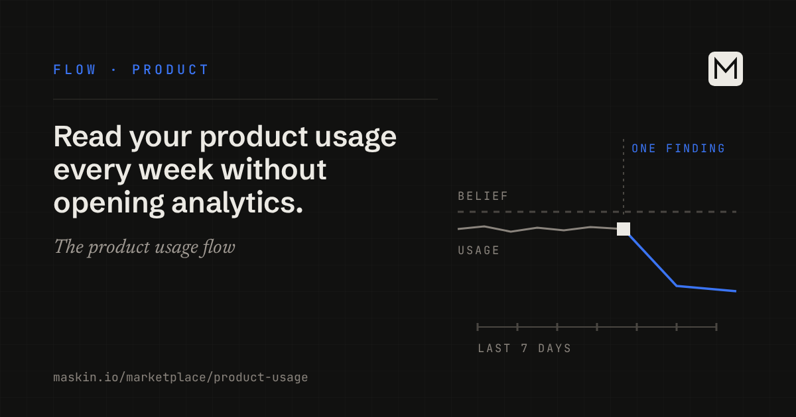

> Source: https://maskin.io/marketplace/product-usage/

# Read your product usage every week without opening analytics.
Run Product usage in Maskin so your team can decide what to improve while Maskin checks the feed and files findings that challenge what you believe.

## The job
Your team gets a written finding when product usage changes what it believes, and no update when nothing changed. Each Monday, Maskin reads the last 7 days of real human usage from the analytics tool you connect and files each result that changed or contradicts what your team believes, with the count behind every number.
**Replaces:** A person opening the analytics tool each week to scan usage by hand.
**Stays with your team:** Deciding whether a finding should change a product decision.

## What your team keeps, what Maskin runs
| Your team keeps | Maskin runs |
| --- | --- |
| Deciding which product beliefs to revisit | Finds usage that changed or contradicts what your team believes |
| Deciding what the numbers mean for a feature or goal | Includes the count behind every number and links the finding to the feature or goal |
| Choosing what to investigate when tracking is missing | Files a finding tagged gap when missing tracking blocks a question |
| Deciding whether a finding merits action | Shows only briefs that would change a decision |
| Deciding whether to change events or dashboards | Leaves events and dashboards unchanged |

## How the Flow runs
1. On Monday at 07:00 UTC, Maskin checks that daily volume looks normal and that there is no gap over 24 hours.
2. If the feed is unhealthy, Maskin says so once on the Flow and stops without filing anything. If access is refused, it says so once and names who can grant it.
3. If the feed is healthy, Maskin reads the last 7 days of real human usage, excluding internal and test accounts.
4. It checks activation from sign-up to a first meaningful action, whether a second person was invited, repeat use, drop-off by product area, and mobile events if you track them.
5. Maskin files one finding for each result that changed or contradicts what your team believes, with the count behind every number and a link to the relevant feature or goal. If missing tracking blocks a question, it files one finding tagged gap.
6. After each Monday read, Maskin refreshes the Results tab with up to three short briefs that deserve a person’s decision, or a quiet state. Each brief says what was found, why it matters, the evidence with counts, what is unknown, and a next step.
7. Tuesday to Friday at 07:56 UTC, an owner check checks the feed, updates the Flow’s target for weekly reads, and runs the Monday read if it did not run. A read with nothing new stays silent.
The blue step is the close condition.

## What you need to run it
- Install the Flow.
- Connect a product analytics tool, such as PostHog, Mixpanel or Amplitude.
- If no analytics tool is connected, the Monday read says so once and stops. If access is refused, Maskin names who can grant it.
- You will first see the Results tab, with qualifying briefs or a quiet state.
- Product discovery is optional. The Flow works without it.

## Trust surface
- **Human gates:** Your team decides whether a finding should change a product decision. Maskin sends nothing.
- **Your data stays yours:** Maskin reads the analytics feed you connect and never changes events or dashboards.
- **Fails safely:** If the feed is unhealthy or unavailable, Maskin says so once and stops without filing findings.

## Example first week
Example for fictional Brightlane, project software for architects.
Monday: The analytics feed is healthy. Maskin reads the last 7 days, excluding Brightlane’s own team.
Monday: The team’s meeting note says, “Mobile is where people abandon setup.”
Monday: No mobile events are tracked, so Maskin files one finding tagged gap instead of claiming where people drop off.
Tuesday: The Results tab shows the finding and what the team could investigate next.
Wednesday: The owner check runs and finds nothing new.
Thursday: The read stays silent.
Friday: Brightlane’s team decides whether to add mobile tracking.

## Install this flow in your workspace
Sign in or sign up, then confirm the flow in the Maskin app.
[Install this flow](/install/product-usage-loop) [Book a walkthrough](https://meshfirm.com/bookmagnus)

## Read next
- [Product discovery flow](/marketplace/product-discovery/): What customers and the market say, grouped into opportunities with the evidence behind each.
- [Customer voice flow](/marketplace/customer-voice/): Customer messages filed as written findings, never replied to.
- [Product release flow](/marketplace/product-release/): Merged work bundled into a release with notes confirmed live.
- [What is an AI-native agentic workspace?](/docs/what-is-an-agentic-workspace/): The cornerstone read on the workspace these flows run in.
